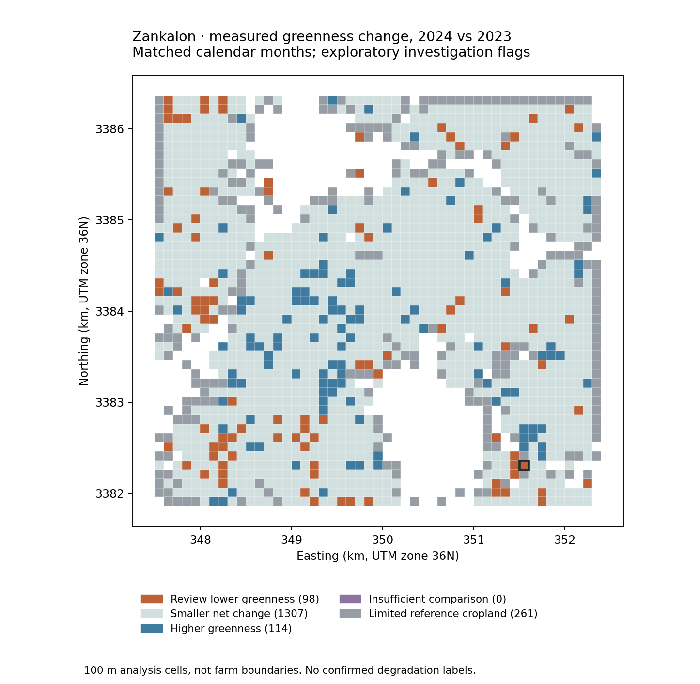
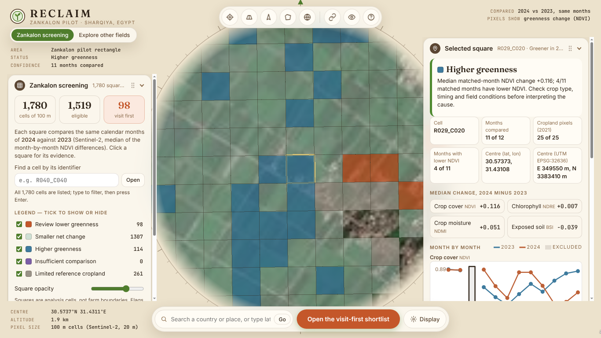

# RECLAIM — Zankalon: where should an agricultural adviser investigate first?

## 1. Title and one-line summary
**Project:** RECLAIM — Zankalon early-warning screening (proof of concept).

**Team:** Mohammed Altemmemi, Fatema Alsabahe, Anfal Benourkhou, Jana Abdou (United Arab Emirates) · **Theme:** Precision agriculture.

**One line:** a transparent, rules-based screening of a 4.7 × 4.4 km pilot rectangle at Zankalon (Sharqiya, Egypt) that compares Sentinel-2 vegetation indices month-by-month between 2023 and 2024 and produces a map plus a shortlist of 98 locations (out of 1,519 eligible 100 m cells) where greenness is clearly lower, so field visits can be prioritised.

**Live dashboard (no install):** https://dist-root-nwtoxtqg.devinapps.com — the Zankalon screening map, cell evidence, a "Field health" panel (four checks, 2024 vs 2023, with explicit no-data states) and the shortlist (static files, no backend needed). The same build is kept in this repository's `gh-pages` branch.

[](https://colab.research.google.com/github/mohammed2008H/Reclaim-Front-End-/blob/main/notebooks/04_Zankalon_Screening.ipynb)

## 2. Business use case
Agricultural advisers, cooperatives and land-reclamation programmes cannot visit every field. They need a cheap, repeatable way to decide **where to look first**. RECLAIM turns free satellite data into an evidence-backed "visit first" list with a plain-language reason for every entry. It does **not** diagnose the cause, estimate yield loss or claim financial savings — those require field verification.

## 3. Problem
A drop in vegetation greenness between two years can signal salinisation, water shortage, abandonment or simply a crop rotation. A single image cannot tell these apart, and two years cannot establish long-term degradation. The problem we solve is narrower and honest: **rank locations by measured, quality-controlled greenness change and show the evidence behind each rank**.

## 4. Data used (all public)
| Source | Use | Licence / attribution |
|---|---|---|
| Sentinel-2 L2A (surface reflectance, 10–20 m) via [Element 84 Earth Search](https://earth-search.aws.element84.com/v1) (`sentinel-2-c1-l2a`), Jan 2023 – Dec 2024 | monthly NDVI, NDRE, NDMI, BSI per 100 m cell, 2023–2024 → **the screening result** | Contains modified Copernicus Sentinel data |
| [ESA WorldCover 2021 v200](https://developers.google.com/earth-engine/datasets/catalog/ESA_WorldCover_v200), class 40 | reference cropland mask (static 2021 reference) | © ESA WorldCover project 2021 |
| [Planet Tanager open sample](https://www.planet.com/data/stac/tanager-core-imagery/catalog.json), collection `agriculture`, scene `20250608_091605_90_4001` (2025-06-08, L1 radiance) | hyperspectral **method demonstration only** — no open scene covers Zankalon; the demo scene is in Konya, Türkiye | Tanager STAC Data © 2025 Planet Labs PBC, CC BY 4.0, adapted |
| [EnMAP](https://www.enmap.org/data_access/) | optional hyperspectral evidence over Zankalon; requires a free DLR account; **not analysed in this submission** (status `not_available`) | DLR licence; private pixels never committed |

The repository contains only small derived inputs (`data/sample_input/`, ~7 MB): per-cell monthly index medians with quality counts, the cell grid, the crop mask, coverage and collection metadata. No full scenes, model weights or intermediate rasters are included. Notebook 02 downloads one 0.9 GB Tanager scene at run time into `work/` (git-ignored).

## 5. Technical approach
1. **Grid:** 1,780 cells of 100 m (nominally 25 Sentinel-2 pixels) over the pilot rectangle `[31.41, 30.56, 31.46, 30.60]`.
2. **Quality rules:** a monthly measurement is kept only if processing is complete, all four indices are finite, ≥ 80 % of pixels were valid and ≥ 2 clear observations entered the median. Nothing is interpolated or filled.
3. **Comparison:** same calendar month 2024 − 2023, only where both months pass. Per cell: median NDVI difference (plus NDRE, NDMI, BSI).
4. **Rules:** eligible = ≥ 9 matched months and ≥ 13/25 cropland pixels. `Review lower greenness` ≤ −0.05, `Higher greenness` ≥ +0.05, otherwise `Smaller net change`; `Insufficient comparison` / `Limited reference cropland` when the gates fail. A sensitivity table reports 0.03 / 0.05 / 0.08.
5. **No model is trained**, thresholds are not validated against ground truth, no accuracy percentage is claimed.
6. Hyperspectral: notebook 02 shows what narrow bands add (reflectance curves, red-edge position, agreement with simulated Sentinel-2 NDRE) on a demonstration scene; notebook 04 attaches real EnMAP evidence only if a checksummed clip is supplied.

7. **Dashboard:** a static web app (Cesium globe) reads a JSON copy of the files in `results/` — it never recomputes anything, and refuses to draw if the copied files disagree with each other. Only the built site is published (`gh-pages` branch); the screening logic lives entirely in notebook 04.

Full file-by-file description for integrators: [`docs/BACKEND_FOR_FRONTEND.md`](docs/BACKEND_FOR_FRONTEND.md).

## 6. Installation
Python 3.10 or newer (verified with 3.10 locally and 3.12 on Google Colab).
```bash
git clone https://github.com/mohammed2008H/Reclaim-Front-End-.git
cd Reclaim-Front-End-
python3 -m venv .venv && source .venv/bin/activate
pip install -r requirements.txt
```
Or open the notebooks in Google Colab; each installs its own pinned packages in its first cell.

**Credentials:** none. No API key, token or account is needed for the headline result; no environment variable has to be set. The optional EnMAP step (off by default) needs a free DLR account.

## 7. How to run
**Headline result (offline, ~5 s):**
```bash
cd notebooks
jupyter nbconvert --to notebook --execute --inplace 04_Zankalon_Screening.ipynb
```
Run from `notebooks/` so the notebook finds `../data/sample_input` and `../src` (it also accepts a ZIP path in `INPUT_ZIP` or a public repo URL in `GITHUB_REPO_URL`). Input SHA-256 hashes are verified before anything runs. **Nothing needs to be edited.** Expected runtime: a few seconds locally (about 1 minute on Colab including package installation), no GPU. At the end the last cell prints `Final results: RECLAIM_Final_Results.zip` and `results/` contains `review_shortlist.csv` (98 rows), `screening_map.png` and `START_HERE.html` (open it in a browser for the offline map).

**Data exploration (needs internet, downloads 0.9 GB once, ~10 min):**
```bash
jupyter nbconvert --to notebook --execute --inplace 02_Zankalon_Open_Data_Explorer.ipynb
```
Writes `results/explorer/`. Both notebooks are committed **with their outputs** from the runs reported below, so results can be read without executing anything. If a catalogue search fails, the notebook records `search_error` in `explorer_status.json` and skips the affected part; nothing is replaced with fake data.

## 8. Example input and output
* Input: `data/sample_input/zankalon_grid_monthly_pilot.csv` — 42,720 rows (1,780 cells × 24 months), columns `cell_id, year, calendar_month, NDVI, NDVI_valid_fraction, NDVI_median_observations, … , reference_crop_pixels, processing_status`.
* Output (`results/`):
  * `review_shortlist.csv` — the 98 flagged cells with a reason sentence, e.g. `R040_C040: Median matched-month NDVI change −0.274; 10/12 matched months have lower NDVI.`
  * `cell_comparison_summary.csv`, `screening_cells.geojson` — all 1,780 cells with status (EPSG:32636).
  * `matched_month_comparisons.csv` — every 2023-vs-2024 month pair behind each median.
  * `monthly_coverage.csv`, `threshold_sensitivity.csv`, `method_and_provenance.json`.
  * `START_HERE.html` — offline interactive map; `screening_map.png`, `example_comparison.png`.
  * `results/explorer/` — Sentinel-2 winter/summer figures, Tanager demonstration figure, `explorer_status.json`.



The same result in the live dashboard (https://dist-root-nwtoxtqg.devinapps.com): click any square for its status, reason, matched months and 2023-vs-2024 monthly charts of all four indices; the 98-cell shortlist is downloadable as CSV.



## 9. Results and limitations
**Result:** 1,780 cells → 1,519 eligible → **98 Review lower greenness**, 1,307 Smaller net change, 114 Higher greenness, 261 Limited reference cropland, 0 Insufficient comparison. Reproduced byte-for-byte on Colab and on a local Ubuntu machine (2026-10-10).

**Validation:** input SHA-256 hashes verified before the run; every cell's median and status re-derived independently from `matched_month_comparisons.csv` (0 mismatches); dashboard numbers checked against the CSVs number by number. The planned acceptance tests are in [`docs/testing/RECLAIM_Testing_Criteria.md`](docs/testing/RECLAIM_Testing_Criteria.md) (original `.docx` alongside) and the executed dashboard tests (T12–T20: map selection, charts, exports/offline, 390/1366 px readability, keyboard use, hyperspectral labelling, responsible reporting) in [`docs/testing/RECLAIM_frontend_test_record.md`](docs/testing/RECLAIM_frontend_test_record.md) with screenshots in `docs/testing/evidence/`. Open items are listed there (Edge browser, five-user usability test, backend criteria T02–T05/T07/T08/T18 not yet formally run).

**Limitations (also shown in the dashboard):** 100 m cells are not farm boundaries and can cross fields; no ownership data; flags are places to investigate, not confirmed degradation; no accuracy percentage was measured; no yield-loss, cost or return estimate; two years do not establish a long-term trend; the crop mask is a static 2021 reference; crop rotation, harvest timing and weather can move the indices. The Tanager figure is a method demonstration on a scene outside Zankalon and its correlation coefficient is not an accuracy score. March 2024 has low coverage (43 % of cells retained) because of clouds.

## 10. Team, licence and attribution
* Team (United Arab Emirates): Mohammed Altemmemi, Fatema Alsabahe, Anfal Benourkhou, Jana Abdou. Theme: Precision agriculture.
* Code: MIT (see `LICENSE`). Data: see the attribution column in section 3; Sentinel-2 — Contains modified Copernicus Sentinel data; WorldCover — © ESA WorldCover project 2021; Tanager — © 2025 Planet Labs PBC, CC BY 4.0, adapted.
* Overview video: coming soon (2–3 min).

## Repository layout
```
README.md                      # this file
requirements.txt               # pinned versions (Python 3.10+)
LICENSE                        # MIT
notebooks/
  02_Zankalon_Open_Data_Explorer.ipynb   # open-data exploration + hyperspectral method demo (with outputs)
  04_Zankalon_Screening.ipynb            # headline result: 98 cells to visit first (with outputs)
data/sample_input/             # small derived inputs (~7 MB), SHA-256 checked by notebook 04
src/enmap_extension.py         # optional EnMAP evidence (only with a supplied, checksummed clip)
results/                       # example output of notebook 04 (+ results/explorer/ from 02)
docs/BACKEND_FOR_FRONTEND.md   # what each output file means and how the dashboard uses it
docs/testing/                  # testing criteria (docx + md), executed test record, evidence screenshots
gh-pages branch                # the built dashboard (live copy: https://dist-root-nwtoxtqg.devinapps.com)
```
